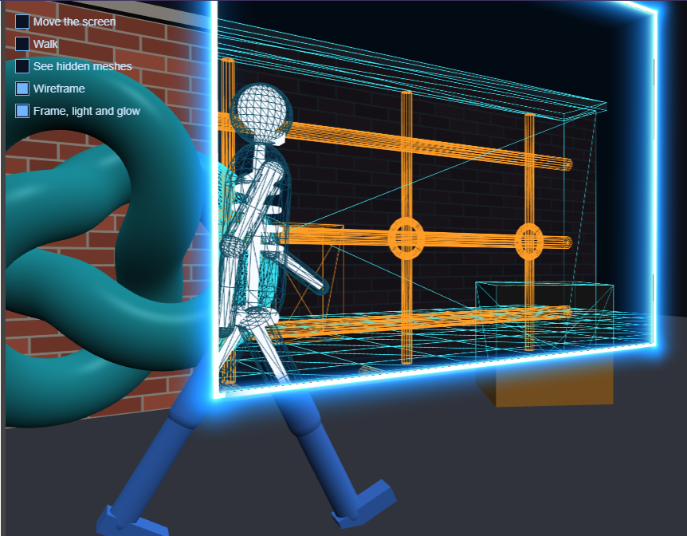

# spatial-display

Displays for 3D scenes. A display shows an image, such as the view of a camera of any scene, as a texture: any mesh surface can show it, in the scene of that camera or in another one. A `Portal` is the ready-made surface: a flat rectangle, the wall of a cylinder or a mesh of the application, which wears a frame, a line of light and a glow when asked, can be resized at run time, and shows an image that can be made see-through.

| Package | Contents |
|---|---|
| `@spacexr/spatial-display-core` | display interfaces, the `Display` and `PhysicalDisplay` base classes, geometry of the frame of a surface and of its halo, of the wall of a cylinder, the open edges of a mesh, image fitting, refresh scheduling. No dependencies, no rendering library. |
| `@spacexr/spatial-display-babylon` | Babylon.js: `CameraDisplay`, `TextureDisplay`, `attachDisplay`, `Portal`, `PortalBuilder` and the surfaces a portal is built on, and the materials of the screen and of the neon. Peer dependency on `@babylonjs/core` 9. |

## Try it

Two of the examples run in the Babylon.js Playground, with nothing to install:

- [An x-ray all around an object](https://playground.babylonjs.com/#F9VTYN#0): a ring whose wall shows the machine it surrounds as a wireframe, from every side, with the parts inside its hull. The same lens on a polygon that is not flat, and on a sphere.
- [An x-ray screen](https://playground.babylonjs.com/#816LOC#1): a window onto its own scene, which sees through a wall of bricks and shows the skeleton of a figure that walks behind it.

[](https://playground.babylonjs.com/#816LOC#1)

Each snippet holds two files: the code of the example, and the library as it is built for the Playground. See [Playground](#playground) below.

## Install

```bash
npm install @spacexr/spatial-display-babylon @spacexr/spatial-display-core
```

`@babylonjs/core` 9 is a peer dependency.

## Getting started

To work in this repository: it requires Node 20 or later, and is an npm workspace.

```bash
npm install
```

```bash
npm test
```

```bash
npm run example:portal
```

```bash
npm run example:xray
```

```bash
npm run example:xray360
```

The portal example opens on http://localhost:5183; add `?window` for the window mode. The x-ray example opens on http://localhost:5184, the x-ray 360 example on http://localhost:5185; add `?polygon` or `?sphere` to start with another surface than the ring. All take `?webgpu` for the WebGPU engine and `?rh` for right-handed scenes.

## Use

```ts
import { CameraDisplay, PortalBuilder, RectSurfaceBuilder, attachDisplay } from "@spacexr/spatial-display-babylon";

// The view of a camera. `world` is a scene the application never renders:
// the display renders it itself, and nothing of it reaches the canvas.
const display = new CameraDisplay({ camera: world.activeCamera!, drive: "display", resolution: { width: 1280, height: 720 } });

// 1. In a portal: a surface that carries the display, and what it wears on its edges.
const portal = new PortalBuilder("gate", scene)
  .withSurface(new RectSurfaceBuilder({ width: 1.6, height: 0.9, display, opacity: 0.85 }))
  .withFrame()
  .withLight()
  .withGlow()
  .build();
portal.root.position.set(0, 1.5, 2);
portal.setDimension(2, 1.2);
portal.opacity = 0.5;

// 2. On any mesh that has texture coordinates.
attachDisplay(scene.getMeshByName("screen")!, display, { fit: "cover" });

// 3. As a plain texture, on a material of the application.
tvMaterial.emissiveTexture = display.texture;
```

## The classes

```
core      Display             an image of a given size in pixels: resolution, resize()
core        PhysicalDisplay   and a rectangle of the world: dimension, setDimension(), pixelPerUnit, dpi
babylon       Portal          and the meshes that draw it: a surface, its frame, its glow, the display it shows
babylon     CameraDisplay     the view of a camera, as a render target: a screen, a window, or a lens
babylon   TextureDisplay      a texture the application already has: a picture, a video
babylon   PortalBuilder       builds a portal step by step: a surface, a frame, a light, a glow
babylon   RectSurfaceBuilder, CylinderSurfaceBuilder, MeshSurfaceBuilder
                              what a portal shows its image on: a flat rectangle, a ring or a bent screen, a mesh
```

Two sizes change apart. `resize(width, height)` is for the image, in pixels. `setDimension(width, height)` is for the rectangle, in world units. Interfaces are named `IDisplay`, `IPhysicalDisplay`, `ITextureDisplay`, and so on for the options of each class.

## How a camera display is drawn

A `CameraDisplay` owns a render target in the scene of its camera, the source scene. That scene and the scene of the surface must belong to the same engine, since a texture cannot be shared between two rendering contexts; nothing else ties them.

`drive` tells who renders the source scene:

- `"app"` (default): the application does. This is the case of a display shown in the very scene it films, and of a scene that is drawn on the canvas as well. A source scene rendered after the scene of the surface shows one frame late.
- `"display"`: the display does, once per frame of the engine, before the render loop of the application. The scene runs as in any render (animations, physics, shadow maps, observables) and nothing reaches the canvas. Several displays of one such scene share a single render.

A surface of a display is kept out of the image of that display: a texture cannot be sampled while it is drawn into. A portal therefore does not show in itself, but two portals facing each other do show one another.

`refresh` is `"frame"` (default), `{ hz }` or `"manual"` with `display.invalidate()`. A display also stops drawing while none of its surfaces is on screen (`pauseWhenHidden`, on by default): a driven scene is then not rendered at all. A surface seen through another display counts as on screen. When a surface comes back into view, it shows its last image for one frame.

The image is the one of a screen: it does not depend on who looks at it, so one draw serves every viewer, both eyes of a headset included.

## Surfaces

`attachDisplay(mesh, display, options)` takes any mesh of Babylon.js that has texture coordinates and a material of its own (not an instance). It gives the mesh an unlit material, and gives it back its former one when the surface is disposed. The image fills the rectangle of the texture space that the mesh uses. `fit` is `"stretch"`, `"contain"` (bands of the `border` color) or `"cover"`, and belongs to the surface: two surfaces can frame the same display differently. A display that is a lens is read otherwise, by the place of the surface on screen: see the lens mode below.

The image shows on the front faces of the mesh. With `doubleSided`, an option of the surface and a property that can change at any time (`surface.doubleSided`, `portal.doubleSided`), it shows on the back faces too: on the back of a flat mesh, where it reads mirrored, and on the inside of a hollow one. The faces turned away from the eye are then drawn first, so through a see-through image the far wall of a cylinder shows behind the near one.

## Transparency

What stands behind a surface shows through it by `1 - opacity * alpha of the pixel`:

- `opacity`, from 0 to 1, applies to the whole image.
- The alpha of a pixel is 1 unless the surface lets the transparent pixels of the image through (`useImageAlpha`). By default a surface follows what the texture says of itself, `texture.hasAlpha`: set it on a picture that has transparent parts, as for any material of Babylon.js. A camera display sets it when it is given a `clearColor` whose alpha is under 1.
- `chromaKey: { color }` lets a color of the image through, as the green of a green screen. For a key with a hue, the share of key color in each pixel is measured, so soft edges and white or gray translucent parts come out as they were shot, with no fringe. Colors akin to the key thin out; narrow `smoothness` to keep them. A translucent part that has a color of its own comes out tinted: a key cannot tell its color from the one behind it.

```ts
// A picture with transparent parts.
const picture = new Texture("logo.png", scene);
picture.hasAlpha = true;
portal.display = new TextureDisplay(picture);

// The world behind the portal, with nothing where it is empty.
const display = new CameraDisplay({ camera, clearColor: { r: 0, g: 0, b: 0, a: 0 } });
```

The colors of a render target are multiplied by their alpha, those of a picture are not; a display says which with `premultipliedAlpha`, and the material blends in premultiplied alpha either way. Light that additive materials drew into a see-through render target, which carries no alpha, is added to what stands behind the surface.

## Portal

A portal is a surface that shows a display, and what that surface wears on its edges. `PortalBuilder` builds one step by step:

```ts
const portal = new PortalBuilder("gate", scene)
  .withSurface(new RectSurfaceBuilder({ width: 1.6, height: 0.9, display }))
  .withFrame(true, 0.02)                              // a tube of square section, 0.02 wide
  .withLight(true, { r: 1, g: 1, b: 1 })              // that tube is a line of light
  .withGlow({ color: { r: 0.1, g: 0.55, b: 1 }, size: 0.18, intensity: 1.4 })
  .build();
```

| Step | What it sets | Default |
|---|---|---|
| `withSurface(surface)` | what the portal shows its image on: a mesh of the application, or a builder of surfaces. The surface carries its display and the way to show it. | required |
| `withFrame(on, section?)` | a tube of square section along the edges of the surface | none |
| `withLight(on, color?)` | lights those edges: the frame becomes a line of light; with no frame, a hairline is drawn along them | none |
| `withGlow(glow)` | a glow on both sides of the edges: `true`, or its `color`, `size`, `intensity`, `falloff`, `cover` and `flow` | none |
| `build()` | the `Portal` | |

Nothing is worn unless asked: with a surface alone, a portal is a mesh that shows a display. `new Portal(name, scene, { surface, frame, light, glow })` takes the same in one call.

### The surface

A surface is what shows the image, and gives the lines the frame runs along. Each builder takes the display (`display`) and the options of `attachDisplay` (`opacity`, `fit`, `doubleSided`, `border`, `useImageAlpha`, `chromaKey`), plus `pixelsPerUnit`.

A flat rectangle. The frame goes around it; it is the one surface that can be a window (see the window mode below):

```ts
new RectSurfaceBuilder({ width: 1.6, height: 0.9, display });
```

The wall of a cylinder, with no cap. The frame runs along its two rims. With a display that is a lens, the ring shows what stands in it from every side:

```ts
const ring = new PortalBuilder("ring", scene)
  .withSurface(new CylinderSurfaceBuilder({ diameter: 1.7, height: 0.8, display, doubleSided: true }))
  .withFrame()
  .withLight()
  .build();
```

A share of that wall is a bent screen: `arc` is the share of a whole turn, and `facing` tells which face shows the image, `"outside"` for a wall that bulges toward who faces the portal, `"inside"` for one that bends around them. The frame then goes all around the screen:

```ts
new CylinderSurfaceBuilder({ diameter: 3.2, height: 0.8, arc: 0.18, facing: "inside", display, fit: "cover" });
```

A mesh the application already has, of any shape. The portal does not own it: the mesh is the node of the portal, it is placed as before, and gets its former material back when the portal is disposed. The frame runs along the open edges of the mesh, which the portal finds from its triangles; a mesh with no edge, as a sphere, gets none.

```ts
// The mesh alone: the portal is given a display later, with portal.display.
const panel = new PortalBuilder("panel", scene).withSurface(sheet).withLight().withGlow().build();

// With its display, and the lines of the frame when the edges of the mesh are not the ones wanted.
new MeshSurfaceBuilder(sheet, { display, doubleSided: true, outlines });
```

`IPortalSurfaceBuilder` is the interface of those builders: an application can write its own, for a surface of another shape.

### Frame, light and glow

- The frame (`portal.frame`) is an opaque tube of square section that stands against the edges of the surface, with mitred corners. `frameSection` is its width. Lit, it is the line of light, of the color `lineColor` (white by default). Not lit, it is a plain solid of the color `frameColor`, which takes the light of the scene.
- The light draws the line however thin or far the frame is: never under `neon.minLineWidth` pixels (1.5 by default). With no frame the line is a hairline on the edge of the surface.
- The glow spreads on both sides of the edges: `glowColor` (an electric blue by default), `glowSize` in world units, `glowIntensity`. It is made of ribbons that turn to face the eye, so it keeps its width from every angle and needs no post-process. Their ends are rounded on the corners of a rectangle; along a curve, as the rim of a ring, they meet on mitres and overlap nowhere.
- The image of the surface is always drawn over the glow: the glow shows around the surface, and through an image that is see-through, never on top of it.

All three can be put on and taken off at any time: `portal.framed`, `portal.lit`, `portal.glowing`. `portal.neon`, the material of the light and of the glow, holds `glowFalloff`, `cover` and `flow` for waves of light that travel along the edges; it is null for a portal with neither. The glow fades from the line outward whatever its intensity. With a `cover` of 1 (default) it tints what stands behind it, so it reads on any color; with 0 it only adds to the background, and is lost on a bright one.

### Size and place

`portal.root` is the node the application places and parents. Facing the front of a flat portal, the local x axis reads to the right and y upward: the front looks toward -z in a left-handed scene, as the planes of Babylon.js, and toward +z in a right-handed one. The middle of a wall stands on that side too, or behind the node for a wall that shows its inside.

`setDimension(width, height)` sizes the surface, in world units: the rectangle, or the wall of a cylinder, whose width is the length of its turn. It rewrites vertex positions and rebuilds nothing, as do `frameSection` and `glowSize`, so a portal can change size at every frame. A mesh of the application keeps its size: the application scales it itself.

The resolution of a portal is the one of its display: showing a display takes its resolution, and `portal.resize()` resizes that display. With `pixelsPerUnit`, the display is resized along with the surface to keep that density; each change then allocates a new render target, so leave it out for a portal whose size is animated and choose a `fit` instead.

## Window mode

A portal is a screen by default: its image is glued to its surface, whoever looks at it. A flat rectangle can be a window instead: with `window`, it gives onto the scene of its display, and the image follows the eye of the viewer:

```ts
// Where the opening stands in the world: a node of that scene. The world lies behind it.
const anchor = new TransformNode("anchor", world);
anchor.position.set(0, 1.5, -6);

const display = new CameraDisplay({ camera: world.activeCamera!, drive: "display" });
const portal = new PortalBuilder("gate", scene)
  .withSurface(new RectSurfaceBuilder({ width: 2, height: 1.2, display, window: { anchor } }))
  .withFrame()
  .withLight()
  .withGlow()
  .build();
```

- The two scenes stay apart. The portal and its viewer are in one; the display draws the other with a camera of its own, which it places where the viewer stands as seen from the opening. The frustum of that camera is skewed so that its sides pass through the edges of the opening: what it draws is exactly what shows in the opening, from any place. Its near plane is the plane of the opening, so nothing of the world shows in front of it.
- The camera given to the display only lends its scene, its far plane and its layer mask. It is not moved.
- The anchor is the frame of the opening in the world: x to the right and y upward when looking into the world, which lies toward +z in a left-handed scene and toward -z in a right-handed one. Its scale sizes the world against the opening. Without an anchor the opening stands at the origin of the world.
- The image is drawn after Babylon.js has updated the camera of the viewer, in the same frame: it does not lag behind the viewer.
- The image always fills the opening: `fit` does not apply.

The glow of the frame carries on behind the opening. Four walls of light run from the edges of the opening straight into the world, as the inside of a box, and fade with depth: `window.glow` sets their `depth`, `intensity`, `falloff` and `color`, and `portal.worldGlowDepth` and `portal.worldGlowIntensity` change them later; `glow: false` leaves them out. A portal with no glow has none behind it either, unless `window.glow` asks for them. Being in the world, they are drawn with it: the wall away from the viewer shows more than the one on their side, and what stands in front of a wall hides it. Only the camera of the window draws them (`WINDOW_LAYER_MASK`); the other cameras of the world do not see them.

`display.setWindow(window, anchor)` does the same for a display shown on a surface of the application, `window` being any object with a `root` node and the `width` and `height` of an opening centred on it.

## One scene: layers and an x-ray

A mesh of Babylon.js belongs to one scene, and so does a camera. To show in a window an object that is costly to draw, without a copy of it in a second scene, keep one scene and tell its cameras apart by layers: a mesh is drawn by a camera when their `layerMask` share a bit.

A display can show the scene its portal stands in. As a window, the portal then needs no anchor: its opening gives onto what stands behind it, seen from the eye of the viewer, and drawn as its display draws it.

```ts
const HIDDEN = 0x20000000;               // a layer the camera of the application does not draw
pipes.layerMask = HIDDEN;

// Never the camera of the scene: it lends the display its layers and its far plane.
const scanner = new FreeCamera("scanner", Vector3.Zero(), scene, false);
scanner.layerMask = 0x0fffffff | HIDDEN;

const wire = new StandardMaterial("wire", scene);
wire.wireframe = true;

const display = new CameraDisplay({ camera: scanner, overrideMaterial: wire, clearColor: { r: 0, g: 0, b: 0, a: 0.8 } });
const portal = new PortalBuilder("xray", scene)
  .withSurface(new RectSurfaceBuilder({ width: 1.6, height: 1, display, window: true }))
  .withFrame()
  .withLight()
  .build();
```

- `overrideMaterial` draws the meshes with another material in the image of the display, and with their own everywhere else: one material for all, or a function that picks one for each mesh. Nothing is copied: a mesh is drawn solid by the camera of the application and as a wireframe by the screen, from the same vertices.
- The camera of the window draws the layers of the camera the display was given, so the screen can see what the application does not show, or less than it shows.
- A portal does not show in the image of its own display: neither its screen nor its frame.
- What the scene sets for all its cameras is shared by the two views: fog, environment, image processing. A light can be kept to some layers (`includeOnlyWithLayerMask`).
- An object seen both around the screen and in it is drawn twice, once for each view.

The x-ray example ([in the Playground](https://playground.babylonjs.com/#816LOC#1)) has a figure that walks around a wall. Its bones are meshes of the hidden layer, carried by the same joints as its body: the camera of the application draws the body, and the screen draws the bones plain and bright, with the body as a faint outline around them, since `overrideMaterial` picks a material for each mesh. The figure so shows as a skeleton when it passes behind the screen, and still does behind the wall, where the eye has lost it.

## Lens mode: an x-ray all around

A window is flat: its camera starts drawing at the plane of its opening. A lens has no such plane, so its surface can have any shape. The display draws what the viewer sees, the way the display draws it, and a surface shows the part of that image it covers on screen:

```ts
const display = new CameraDisplay({
  camera: scanner,
  overrideMaterial: wire,
  clearColor: { r: 0, g: 0, b: 0, a: 0.85 },
  include: (mesh) => machine.has(mesh),
});
display.setLens({ scene }); // follow the camera of this scene

// A ring around the machine: its wall shows the machine as a wireframe, from every side.
const ring = new PortalBuilder("ring", scene)
  .withSurface(new CylinderSurfaceBuilder({ diameter: 1.7, height: 0.8, display, doubleSided: true }))
  .withFrame()
  .withLight()
  .build();

// Or on any mesh the application has, with no portal.
attachDisplay(bubble, display);
```

Any mesh that has texture coordinates will do. The example ([in the Playground](https://playground.babylonjs.com/#F9VTYN#0)) has three: the ring, a portal on the wall of a cylinder; a polygon made of its own vertices, bent and twisted, that circles the machine, which a portal takes as it is and whose edge it lights; and a sphere that closes on a part of the machine.

- The display draws with a camera of its own, a copy of the one of the viewer: same place, same direction, same projection. The copy is made after Babylon.js has updated the camera of the viewer, in the same frame. The camera given to the display lends its scene and its layer mask, as for a window, and is not moved.
- The image takes the size of the canvas, so a surface is as sharp as the rest of the screen; `scale` in the lens asks for less, or for more. `resize()` does not hold.
- A surface reads the image where each of its points lands on screen, not by its texture coordinates: `fit` does not apply. Several surfaces can share a lens, and a portal shows one as any surface does.
- With `doubleSided`, the inside of the surface shows the image too: the far wall of the cylinder, seen over the near one, and the whole wall for a viewer who stands inside. Both faces read the same image, so where they overlap the glass is twice as dark.
- Nothing is cut in front of a surface, nor behind it: the image holds whatever the copy draws along the line of sight. Choose it with the layers of the camera given and with `include`.
- A lens can show another scene: `display.setLens({ scene, root }, anchor)` places the copy in the scene of the display, at the place the viewer has against `root`, taken from `anchor`. The two scenes must have the same handedness.

## WebGL and WebGPU

The two materials are written in GLSL and in WGSL, and pick their language from the engine: WebGPU does not have to translate GLSL. The two versions of each shader live side by side in `packages/babylon/src/materials/shaders.ts`.

## Playground

The Playground holds Babylon.js as the `BABYLON` global. A package imported there by its name comes from a CDN with a Babylon.js of its own, and two of them do not work together. `examples/playground/bundle.mjs` therefore builds the library as one module that reads Babylon.js from that global. A snippet holds it as a second file, `spatial-display.js`, next to the code of the example, which imports it:

```js
import { CameraDisplay, PortalBuilder, RectSurfaceBuilder } from "./spatial-display";
```

`examples/playground/xray.js` and `xray360.js` are the two examples as their snippets hold them: the code of `examples/xray` and of `examples/xray360`, written for the Playground, with its `BABYLON` global and its interface. To save one again after a change:

```bash
npm run playground:bundle
```

```bash
node examples/playground/publish.mjs xray 816LOC
```

The second command saves a new revision of the snippet `816LOC` and prints its address; `xray360` goes with `F9VTYN`, and without an id a new snippet is made. A snippet is public, and stays: the links of this file name the revision they show.

## Scripts

| Command | |
|---|---|
| `npm run build` | compile the packages (`tsc -b`) |
| `npm run typecheck` | packages plus tests and examples |
| `npm test` | Vitest, with the null engine of Babylon.js |
| `npm run example:portal` | the portal example, served by Vite from the sources: a flat portal, a bent screen |
| `npm run example:xray` | the x-ray example: a window onto its own scene, a wall, a walker and its skeleton |
| `npm run example:xray360` | the x-ray 360 example: a lens on a ring, on a polygon that is not flat, on a sphere |
| `npm run playground:bundle` | the library as one module for the Babylon.js Playground, in `examples/playground/out` |

## Releasing

The core and the Babylon.js adapter are published to npm under the `@spacexr` organization, at the same version, by [.github/workflows/release.yaml](.github/workflows/release.yaml) when a tag `vX.Y.Z` is pushed. The workflow checks that the tag carries the version of every `packages/*/package.json`, builds, runs the type check and the tests, and publishes each package from its workspace.

```bash
npm version 0.2.0 --workspaces --no-git-tag-version   # both packages
# then set the same version in the peer range of babylon on the core
git commit -am "Release 0.2.0"
git tag v0.2.0
git push origin main
git push origin v0.2.0
```

The workflow publishes through npm trusted publishing (OIDC), with no token. A package must exist on npm before a trusted publisher can be set on it, so the first version is published by hand, from the root, after `npm run build`:

```bash
npm publish --workspace @spacexr/spatial-display-core --access public
npm publish --workspace @spacexr/spatial-display-babylon --access public
```

Then, on npmjs.com, each of the two packages gets this repository and `release.yaml` as its trusted publisher.

Each package is published with its own `README.md` and a copy of the license; `npm pack --dry-run --workspace <name>` lists what a tarball holds.

## State and limits

The examples have been checked in a browser on WebGL2 and on WebGPU, in left- and right-handed scenes. On WebGL2, in both handednesses, the pixels of the canvas were compared with what the transparency rule above predicts, for a picture with alpha and for a camera display with a see-through background: they agree within 1/255 away from edges. In window mode, also on WebGL2 and in both handednesses, objects of the world were found on the canvas where their place behind the opening predicts, from three places of the viewer. On WebGPU the checks were by eye. The lens of the x-ray 360 example was checked by eye on WebGL2 and on WebGPU, in both handednesses; the tests compare the camera of a lens with the one of its viewer. The frame, the light and the glow of a portal were checked by eye on a flat rectangle, on a bent screen, on a ring and on a mesh of the application: each in left- and right-handed scenes, and all but the last on both WebGL2 and WebGPU. Putting them on and taking them off was checked on the flat one, on WebGL2. The walker of the x-ray example and its skeleton were looked at on WebGL2 in a left-handed scene and on WebGPU in a right-handed one. The two snippets were run in the Playground itself, on WebGL2, with Babylon.js 9.37; the library built for the Playground was also run on WebGPU, in a page that loads Babylon.js as the Playground does. Nothing has run in a headset.

The examples serve Babylon.js unbundled (`optimizeDeps.exclude` in their Vite configuration). Bundled ahead by Vite 7, the shaders that Babylon.js materials import on demand came with a second copy of its shader store, and those materials failed to compile.

- A window draws one image, for the camera of the scene its opening stands in. In a headset both eyes get that same image: the world behind the opening shifts as the head moves, but has no depth of its own. A portal seen through another display, or by a second camera, shows the image drawn for the first.
- A window keeps its last image when the viewer goes behind its opening.
- Only a flat rectangle can be a window.
- A lens draws one image too, for the camera of the scene it follows, with the same limits in a headset and for a second camera. It cuts nothing in front of its surfaces.
- A mesh needs texture coordinates to be a surface, even for a lens, which does not use them.
- The glow of a portal is drawn before its whole surface. On a hollow surface that shows both its faces, as a ring, the far wall is therefore drawn over the glow of the near rim: seen from outside, the near rim keeps its line but shows no glow against the inside of the ring.
- The frame of a portal on a mesh of the application is counted in the space of that mesh: a mesh that is scaled thickens its tube. The light and the glow keep their size.
- The rim of a ring seen exactly edge on ends its glow square, where the rim turns away from the eye.
- The scale of the anchor of a window is taken as the same along its three axes.
- No pointer input goes through a surface to the scene behind it yet.
- A portal does not show in itself.
- The materials of the screen and of the neon ignore fog, clip planes and instances. For those, give `display.texture` to a material of the application.
- A source scene that uses `activeCameras` cannot be driven by a display.
- Layers of the source scene that are not drawn in render targets (glow, highlight) do not show in a display. The post-processes of the camera do, with `postProcesses: true`.
- Babylon.js adds up the alpha of blended materials in a render target. Where several translucent objects overlap over a see-through background, the image is more opaque than it should be.

## License

Apache-2.0. See [LICENSE](LICENSE).
